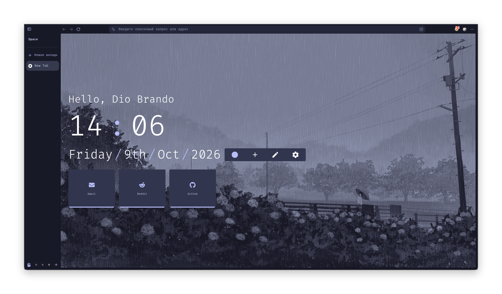

# <p align="center"> Violet-Zen

<p align="center">
  
</p>
<p align="center">  This is my dotfiles for Zen Browser.

## Install:
Clone this repository:
```bash
git clone https://github.com/L0rdDioBrando/Violet-Zen.git && cd Violet-Zen
```

Find the path to the Zen profile folder in about:support.
Copy my Zen settings:
```bash
cp ./user.js <your-zen-profile-folder>/ && cp -r ./chrome/ <your-zen-profile-folder>/
```

Install Night Tab extension and import the import.json file.
